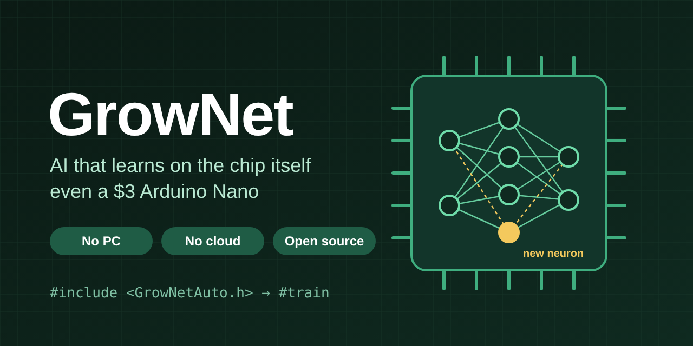

<p align="center">
  
</p>

<p align="center">
  <a href="https://github.com/vihangaarunalu/GrowNet/actions/workflows/ci.yml"></a>
  <a href="https://github.com/vihangaarunalu/GrowNet/releases"></a>
  <a href="LICENSE"></a>
  
  
</p>

<p align="center">
  <b><a href="#quick-start-no-extra-hardware">Quick start</a></b> ·
  <b><a href="#new-one-line-then-just-talk-to-it">One-line mode</a></b> ·
  <b><a href="#examples">Examples</a></b> ·
  <b><a href="#api">API</a></b> ·
  <b><a href="#honest-limits">Limits</a></b> ·
  <b><a href="CONTRIBUTING.md">Contribute</a></b>
</p>

# GrowNet

**Teach any microcontroller by example, and it learns on the chip itself, even a $3 Arduino Nano. No PC, no cloud.**

| 🧠 Learns on the chip | 🔍 Explains your sketch | 🛡️ Honest |
|---|---|---|
| Show it examples and it trains itself with backpropagation, right on the board. Grows its own neurons to fit the chip. | Add one `#include` and it reports links, likely drivers, stuck sensors and unusual events. Type `#train` and it learns normal behaviour. | Says **"I don't know"** instead of guessing, and lists exactly what it can't do. |

<!-- Add a GIF of your board learning live here: it's the most important thing in this README -->
<!--  -->

```cpp
GrowNet net;
net.begin(2, 3, pool, sizeof(pool));   // 2 sensors, 3 situations

net.teach(sensors, NORMAL);            // learns right here, on the chip
uint8_t what = net.predict(sensors);   // NORMAL, FAULT ... or GrowNet::UNKNOWN
```

## New: one line, then just talk to it

Add `#include <GrowNetAuto.h>` to your own Arduino code and change nothing else. Open the Serial Monitor (115200 baud, line ending "Newline"):

```
[GrowNet] Ready. Watching your sketch. Type #train to learn how it normally behaves.
#train
[GrowNet] Training... using 2 inputs and 1 on/off outputs. Keep the system running normally.
[GrowNet] Training... 10 s, 31 examples, 4 neurons, accuracy on new readings 88%
[GrowNet] Training done in 40 s: 52 examples, accuracy on new readings 100%
[GrowNet] Send the trained data as CSV? Type #yes or #no
#yes
--- GrowNet CSV begin ---  ...copy straight into Excel or Google Sheets...  --- GrowNet CSV end ---
[GrowNet] Show links between signals and likely drivers? Type #yes or #no
#yes
[GrowNet] LED is ON mostly when light is high (avg 691 when ON, 306 when OFF) - likely driver
[GrowNet] Trained. Watching for unusual situations and unexpected outputs.
...
[GrowNet] Unexpected: LED is OFF, but in this situation it was usually ON. Type #ok if this is normal now.
[GrowNet] Unusual situation, not seen during training: light=1020, knob=315. Type #ok if this is normal.
```

- **Learns how your system normally behaves**: which on/off outputs go with which inputs.
- **Then watches for problems**: situations it never saw, and outputs that act differently from what it learned.
- **Remembers**: the model is saved (EEPROM) and reused after a restart. New sensors are added later without losing what it learned.
- **Plays nicely with your sketch**: GrowNet only reads Serial lines that start with `#`.
- **Scales with the board**: Arduino Nano is the baseline; ESP32, RP2040 and Nano 33 BLE watch more signals and train bigger models.

Commands: `#train` `#yes` `#no` `#csv` `#links` `#ok` `#status` `#reset` `#help`. See the `InsightAuto` example.

## What it is

GrowNet is a small, open-source machine learning library for microcontrollers. It lets a device **learn from examples directly on the chip**, even an Arduino Nano with only 2 KB of RAM. There's no PC training, no Python and no cloud.

## Why it's needed

Most microcontroller AI is trained once on a PC and then frozen. It can't adapt to a new machine, a new room or a change over time without a developer retraining it. GrowNet keeps learning **where the data is**, so anyone can teach a device by example. It answers in milliseconds, works offline, and keeps your data on your own device.

## What's new

Compared with existing tools such as Edge Impulse, ST NanoEdge and TensorFlow Lite Micro, GrowNet combines in one small library:

1. **On-device learning on the cheapest 8-bit chips**, not only on larger 32-bit boards
2. **A network that sizes and grows itself** to each chip's memory, with no settings
3. **Built-in "I don't know"**, so it doesn't confidently guess on unfamiliar input
4. **Add sensors later without losing what it learned** (v0.2.0)
5. **One line to watch any existing sketch** and explain what it finds (v0.3.0)
6. **Guided training from the Serial Monitor**, CSV export, and warnings when the system stops behaving normally (v0.4.0)

## Capabilities

| Capability | What it means |
|---|---|
| **Learns on the device** | Show it a situation and it trains itself with backpropagation, on the chip, in seconds |
| **Recognizes situations** | From any sensors, with a confidence score |
| **Says "I don't know"** | Returns `GrowNet::UNKNOWN` for input unlike anything it was taught |
| **Grows by itself** | Starts with 4 neurons and adds more only when needed, without forgetting |
| **Fits any board** | 153 parameters on a Nano, 12,000+ on an ESP32, from the same code |
| **Any sensor, any units** | Learns each input's range itself: ADC counts, °C, lux, amps... |
| **Add sensors later** | `addInput()` brings in a new sensor and keeps everything learned |
| **Watch any sketch (Insight)** | One `#include` reports links, what drives each output, stuck or unlinked sensors, unusual values and flicker |
| **Guided training** | `#train` learns the system's normal behaviour, exports CSV, then warns about unusual situations and unexpected outputs |
| **Remembers** | Saves its brain (weights and memory of examples) to EEPROM |
| **Portable brain** | A saved brain loads on a different board with identical answers |
| **Keeps learning after loading** | Teach more at any time; no retraining from scratch |
| **Fast, offline answers** | Decisions on the device, no network round trip |
| **No dependencies** | One header, plain C++, no `malloc`; also runs on a PC |

## Quick start (no extra hardware)

1. Download this repo as a ZIP. In the Arduino IDE choose **Sketch → Include Library → Add .ZIP Library**.
2. Open **File → Examples → GrowNet → HelloGrowNet**.
3. Upload to any board and open the Serial Monitor at **115200** baud.

You'll see it learn three situations, recognize new readings, and answer "I don't know" for a situation it was never taught.

## Examples

| Example | Hardware | What it shows |
|---|---|---|
| `HelloGrowNet` | None | Learning, testing and "I don't know" with simulated sensors |
| `SerialTeach` | Any 2–3 analog sensors | Teach from the Serial Monitor, add a third sensor later, saved to EEPROM |
| `ButtonTeach` | 2 sensors, 2 buttons, 3 LEDs | A teachable device with no computer at all |
| `VibrationMonitor` | MPU6050 | Learn a machine's normal vibration and flag faults |
| `InsightAuto` | Any sensor on A0 | An ordinary sketch plus one `#include` line; GrowNet explains what it sees |

## Adding a sensor later

Reserve room when you start, then add the sensor whenever it's connected:

```cpp
net.begin(2, 3, pool, sizeof(pool), seed, 3);   // 2 sensors now, room for 3
// ... teach and use it ...
net.addInput();                                   // the third sensor is now part of the brain
```

The new sensor starts with zero influence, so all answers stay exactly the same. Over the next few `teach()` calls it learns how much the new sensor matters. Old examples, recorded before the sensor existed, assume the first value it reads. Each reserved input costs a little memory per neuron.

## Guided training in detail

| Step | What happens |
|---|---|
| `#train` | Records inputs and the on/off pattern of outputs, learning a little at a time so your sketch keeps running |
| Progress | Every 10 s: examples kept, neurons, and accuracy measured on **new** readings (not ones it memorised) |
| Done | After at least 30 s and two checks at 95% or more on new readings (at most 3 minutes) |
| `#yes` to CSV | Signals (min, max, average, spread), links, likely drivers, model summary |
| `#yes` to links | Links between signals and the likely driver of each output |
| Afterwards | Warns when inputs are outside the trained range or unlike anything seen, or an output disagrees with what it learned. A warning needs about 3 seconds in a row, then repeats at most every 30 s |
| `#ok` | Teaches the current situation as normal |
| Restart / code change | Model loads from EEPROM; a new input is added without losing learning; `#train` again to include new outputs |

Limits of guided training:

- Inputs up to 4 and on/off outputs up to 2 on a Nano (8 and 3 on bigger boards). On a Nano, GrowNetAuto uses about 1.1 KB of the 2 KB RAM, so large sketches may not fit.
- It learns **normal from what it sees**: if the system is faulty while training, that becomes "normal".
- Expect occasional borderline warnings near the edges between situations; `#ok` teaches them away.
- The model is saved at the start of EEPROM (change with `#define GROWNET_AUTO_EEPROM_ADDR`, or turn off with `#define GROWNET_AUTO_NO_SAVE` if your sketch uses EEPROM).
- The Nano 33 BLE has no EEPROM support here, so its model is not kept after power-off.

## GrowNet Insight in detail

| Message | What it means |
|---|---|
| **move together / opposite** | Two signals rise and fall together (or one rises as the other falls), link strength 0.7 or more |
| **is ON mostly when …** | The input that best explains when an on/off output is ON |
| **never changes** | An input that has had the same value for the whole time |
| **no clear link to anything** | An input unrelated to every other signal; maybe not needed |
| **Unusual** | A reading far outside its usual range (5 standard deviations) |
| **switching very often** | An output that changed more than 20 times in 10 seconds |

Optional extras:

```cpp
GrowNetAuto::name(A0, "temperature");               // readable names
GrowNetAuto::watch("humidity", dht.readHumidity()); // values from sensor libraries
GrowNetAuto::control("servo", angle);               // outputs from libraries
GrowNetAuto::summary();                             // print all findings again
```

Good to know:

- Put `#include <GrowNetAuto.h>` **after** your other includes.
- On AVR boards it starts Serial at 115200 if your sketch hasn't; on other boards call `Serial.begin(115200)`.
- Findings start after about 10 seconds of watching and are repeated only when they change.
- Insight uses on-chip statistics (correlation, running averages, outlier checks). It finds **links, not causes**: you decide what they mean.
- Library sensors (DHT, ultrasonic libraries...) are only seen if you pass their values with `watch()`.

## How big can it grow?

Capacity for 2 inputs and 3 situations. The library picks the memory budget for your board automatically; define `GROWNET_POOL_BYTES` before including it to change it.

| Board | Memory used | Max neurons | Max parameters | Examples remembered |
|---|---|---|---|---|
| Nano / Uno | 1,000 B | 25 | 153 | 50 |
| Leonardo | 1,300 B | 33 | 201 | 65 |
| Mega | 5,000 B | 132 | 795 | 250 |
| STM32 | 6,000 B | 167 | 1,005 | 255 |
| SAMD21 | 16,000 B | 524 | 3,147 | 255 |
| ESP8266 | 20,000 B | 667 | 4,005 | 255 |
| ESP32 | 60,000 B | 2,095 | 12,573 | 255 |
| RP2040 / Nano 33 BLE | 100,000 B | 3,524 | 21,147 | 255 |

## How it works

1. **Memory plan:** `begin()` splits one fixed buffer into a workspace, a memory of recent examples, and as many neurons as fit.
2. **Network:** inputs → one hidden layer of tanh neurons → softmax over your situations.
3. **Teaching:** each `teach()` stores the example, then trains with gradient descent until it reaches `targetAccuracy` (default 97%) or `maxEpochs`.
4. **Growing:** if accuracy is still too low, it adds a neuron with zero output weights, so it can't disturb existing answers, then trains again.
5. **Scaling:** when a value falls outside an input's known range, the range widens, and stored examples and first-layer weights are remapped exactly, so nothing learned is lost.
6. **"I don't know":** it compares the distance to the nearest remembered example with how far apart remembered examples usually are. Too far, or too low confidence, gives `UNKNOWN`.

## API

| Call | What it does |
|---|---|
| `begin(nIn, nOut, pool, bytes, seed, maxInputs)` | Set up inside your buffer; returns `false` if it doesn't fit |
| `teach(x, label)` | Learn that raw inputs `x` mean situation `label` |
| `predict(x)` | Situation number, or `GrowNet::UNKNOWN` |
| `addInput()` | Start using one more sensor, keeping what was learned |
| `confidence()`, `probability(k)` | How sure the last prediction was |
| `bestGuess()`, `isUnknown()`, `novelty()` | Details of the last prediction (`novelty() > 1` = unfamiliar) |
| `improve(passes)` | Extra training, e.g. while the device is idle |
| `accuracy()` | Accuracy on the remembered examples |
| `reset()` | Forget everything |
| `save(writeFn)`, `load(readFn)`, `saveSize()` | Store the brain anywhere through two byte callbacks |
| `inputs()`, `neurons()`, `params()`, `maxParams()`, `examples()` | Size information |

Settings: `learningRate`, `targetAccuracy`, `maxEpochs`, `maxGrowPerTeach`, `minConfidence`, `noveltyFactor`, `detectUnknown`.

`GrowNetEEPROM.h` adds one-line `GrowNetEEPROM::save(net)` and `load(net)` for AVR, ESP32, ESP8266 and RP2040.

## Test results

The PC test suite (`extras/test`) uses the exact Nano memory budget:

- Learns 3 situations from raw sensor values: 300/300 correct on new readings
- Answers `UNKNOWN` for a situation never taught (about 16× the usual distance)
- Grows from 4 to 6 neurons on a harder ring-shaped pattern (≈85% on new points)
- Brain moves from a Nano-sized to an ESP32-sized setup with identical answers
- Widening an input range keeps learned answers unchanged
- Adding a sensor keeps old answers unchanged, then learns a new situation that needs it (90/90)
- Whole brain fits in the Nano's 1 KB EEPROM
- Insight, with Nano limits: finds linked, opposite, stuck and unlinked signals, the input driving an output, an injected spike and a flickering output, with no false alarms on a random signal

Timing on real boards is not measured yet. Contributions with measurements are very welcome.

## Do you need this?

| Use GrowNet if… | Don't if… |
|---|---|
| You can show examples but can't easily write the rule | A simple `if` threshold already works |
| Each device or site behaves differently | Every device behaves the same |
| You want learning on the device, with no cloud | Cloud processing is fine for you |
| You use small, cheap boards | You need language, image or audio AI |

## Honest limits

- It recognizes **patterns in numbers**. It's machine learning, not a chatbot: it doesn't understand language or code.
- It only knows situations it was taught. "I don't know" makes that visible, but can't make it perfect.
- On-chip training stays small on a Nano (about 150 parameters).
- It remembers a limited number of recent examples (50 on a Nano). Older ones are replaced.
- Raw audio or images need feature extraction first (see `VibrationMonitor`).
- **Never use it alone for safety-critical decisions** such as fire, gas or medical alarms.

## Roadmap

- [ ] Timing and power benchmarks on real boards
- [x] One-line `#include` that watches existing Arduino code (v0.3.0)
- [x] Guided training, CSV export, monitoring and reuse after changes (v0.4.0)
- [ ] Bluetooth / phone app for the same commands
- [ ] `AI_GUIDE.md` so AI coding tools write GrowNet-ready code
- [ ] Robot "drive to teach" example
- [ ] Sleeping neuron groups, using SD cards or extra memory when attached
- [ ] Desktop and phone app for teaching without code

## Contributing

Issues, measurements on new boards and new examples are all welcome. Please run the PC tests before opening a pull request:

```bash
g++ -std=c++11 -Wall -Wextra -O2 -Isrc extras/test/test_grownet.cpp -o test_grownet && ./test_grownet
g++ -std=c++11 -Wall -Wextra -O2 -Isrc -D__AVR_ATmega328P__ extras/test/test_insight.cpp -o test_insight && ./test_insight
```

## Support the project

- ⭐ **Star the repo** if GrowNet is useful or interesting to you. It helps others find it.
- 🧪 **Tried it on a board?** [Share your results](https://github.com/vihangaarunalu/GrowNet/issues/new?template=board_report.yml), especially timings on real hardware.
- 🐛 **Found a problem?** [Open an issue](https://github.com/vihangaarunalu/GrowNet/issues/new/choose).
- 🛠️ **Built something with it?** Open an issue with a photo or video and it can be featured here.

## License

MIT. See [LICENSE](LICENSE). Created by **Vihanga Arunalu Karunathilaka**.
